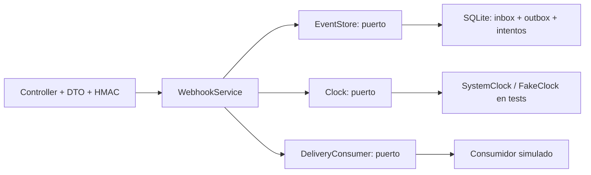

# Reliable Webhooks Lab

Laboratorio de backend en **NestJS, TypeScript y SQLite**: recibe un evento firmado, guarda el evento y su tarea de entrega en una transacción y permite observar duplicados, fallos y reintentos. El consumidor es simulado y no realiza solicitudes externas.

Muestra decisiones concretas de arquitectura: puertos/adaptadores, idempotencia con conflicto de contenido, transactional outbox, leases recuperables y pruebas de fallos. Es código nuevo de portafolio creado en noviembre de 2026 con asistencia de IA. Todos los ejemplos son sintéticos; no contiene código ni datos de clientes. Ver [NOTICE](NOTICE).

## Probar en cinco minutos

Requiere **Node.js 24.x y npm**. No necesita Docker, base de datos externa, cuenta cloud ni claves de proveedores. La instalación descarga paquetes públicos; después la demo funciona localmente.

```sh
npm ci --ignore-scripts
npm test
npm start
```

`npm test` compila el proyecto. Si omitís las pruebas, ejecutá `npm run build` antes de `npm start`.

En una segunda terminal, desde esta carpeta:

```sh
npm run demo
```

El script envía un evento `fail-once` con un ID nuevo, vuelve a enviarlo, dispara la primera entrega, espera el backoff y verifica la segunda entrega. Comprueba con aserciones:

1. Primera recepción: `duplicate: false`, estado `pending`.
2. Mismo evento: `duplicate: true`, sin una segunda tarea.
3. Primera entrega: `pending`, `attempts: 1`.
4. Reintento: `delivered`, `attempts: 2`, historial `failed → succeeded`.

La API escucha exclusivamente en `http://127.0.0.1:4311`. Abrí [Swagger UI](http://127.0.0.1:4311/docs) o [OpenAPI JSON](http://127.0.0.1:4311/openapi.json). Detenela con Ctrl+C. `PORT` permite elegir otro puerto local; la dirección de escucha sigue siendo loopback.

La base `data/demo.sqlite` queda en esta carpeta y sobrevive a un reinicio. Reenviar un ID con otro contenido devuelve `409`; usá otro ID para un evento nuevo. El script `demo` genera un ID distinto en cada ejecución. No hay proceso en segundo plano: las entregas avanzan al llamar `POST /demo/dispatch`.

## Recorrido con curl

La firma cubre los **bytes exactos** del archivo, incluidos espacios y saltos de línea. La clave pública del laboratorio es `local-demo-secret-not-for-production`. `DEMO_SECRET` puede sobrescribirla tanto en el servidor como en los scripts; no es necesario configurarla para probar.

PowerShell:

```powershell
$signature = node scripts/sign.mjs examples/event.json
curl.exe -i http://127.0.0.1:4311/events -H "Content-Type: application/json" -H "x-demo-signature: $signature" --data-binary "@examples/event.json"
curl.exe -X POST http://127.0.0.1:4311/demo/dispatch
curl.exe http://127.0.0.1:4311/events/demo-001
```

Bash:

```sh
signature=$(node scripts/sign.mjs examples/event.json)
curl -i http://127.0.0.1:4311/events \
  -H 'Content-Type: application/json' \
  -H "x-demo-signature: $signature" \
  --data-binary @examples/event.json
curl -X POST http://127.0.0.1:4311/demo/dispatch
curl http://127.0.0.1:4311/events/demo-001
```

Para `fail-once`, esperá hasta `nextAttemptAt` (Unix milisegundos; 1 segundo tras el fallo) y volvé a ejecutar `POST /demo/dispatch`. Para observar `dead`, enviá otro ID con `deliveryMode: "always-fail"`: falla en el intento 1, espera 1 s, falla en el 2, espera 2 s y termina en el 3. Firmá nuevamente cada cuerpo modificado.

| Endpoint | Resultado |
| --- | --- |
| `GET /health` | Verifica que SQLite responda. |
| `POST /events` | `200` nuevo o duplicado idéntico; `409` si el ID cambia de contenido. Requiere HMAC. |
| `GET /events?limit=20` | Últimos eventos; límite entre 1 y 100. |
| `GET /events/:eventId` | Estado, intentos, próximo vencimiento e historial; `404` si no existe. |
| `POST /demo/dispatch` | Procesa hasta 20 tareas vencidas con el consumidor simulado. |
| `GET /docs`, `GET /openapi.json` | Contrato interactivo y JSON. |

Los campos desconocidos o inválidos devuelven `400`, la firma ausente/incorrecta `401` y un cuerpo JSON mayor a 16 KiB `413`. `reference` admite hasta 64 caracteres, `message` hasta 500 y `eventId` hasta 80, limitado a letras ASCII, números, guion y guion bajo.

## Arquitectura y garantías



- **Dominio**: evento, estados y política de tres intentos. No importa NestJS ni SQLite.
- **Aplicación**: normaliza campos para un hash estable, acepta el evento y coordina entregas mediante puertos.
- **Adaptadores**: SQLite ejecuta `BEGIN IMMEDIATE`, registra inbox/outbox conjuntamente y usa `event_id` como clave primaria. El hash detecta reutilización incompatible; el orden de las claves JSON no cambia su significado.
- **Entrega**: una transacción reclama la tarea con token y lease de 30 s. El resultado y el historial se guardan juntos. Un lease vencido permite recuperar el trabajo; un token anterior no puede finalizar una tarea reclamada de nuevo. El intento abandonado cuenta para el máximo de tres.
- **Durabilidad local**: SQLite usa WAL y `synchronous=FULL`. Las pruebas verifican reapertura y rollback; no simulan un corte de energía ni prueban disponibilidad distribuida.

El patrón representa **entrega al menos una vez con reintentos acotados**. Si un receptor real ejecutara una operación y el proceso cayera antes de guardar el resultado, podría recibirla nuevamente. No se promete exactly-once. Un adaptador real necesitaría idempotencia del receptor, timeout, política de errores y observabilidad. Aquí no se envía nada a un receptor real.

```text
src/domain/        tipos y política de reintentos
src/application/   puertos y casos de uso
src/adapters/      persistencia SQLite, reloj y consumidor simulado
src/http/          contrato HTTP, DTO y firma
test/              pruebas de contrato, persistencia y fallos
docs/producto/     seis documentos de alcance y decisiones
```

## Qué se verifica

`npm test` usa el runner nativo de Node. Incluye 16 recepciones HTTP simultáneas del mismo evento, 8 despachos simultáneos, conflicto de contenido, rollback ante fallo de outbox, reapertura SQLite, recuperación de leases y rechazo de finalización tardía. Un reloj falso prueba backoff, éxito posterior y agotamiento sin esperar tiempo real. También cubre DTO, HMAC, límite de cuerpo, 404 y contrato OpenAPI.

No se presentan cifras de rendimiento ni cobertura porcentual. Los tests de archivo usan directorios temporales propios y los eliminan al terminar; no utilizan la base de la demo.

El [workflow CI](.github/workflows/ci.yml) ejecuta instalación desde lockfile, compilación y tests con Node 24 en GitHub Actions. Usa permiso de lectura del repositorio, acciones fijadas por commit y no requiere secretos adicionales.

## Límites deliberados

Es una muestra educativa local, **no un servicio listo para producción**. La clave HMAC por defecto es conocida y demuestra verificación, no control de acceso. No hay usuarios, autorización administrativa, firma con ventana temporal, rate limit, retención, cifrado, scheduler ni despliegue. Las consultas y el control `/demo/dispatch` son locales y no autenticados. No lo expongas mediante túneles o proxies públicos.

La firma HMAC detecta cambios en el cuerpo; no proporciona frescura temporal. La deduplicación no caduca en este laboratorio. SQLite síncrono simplifica la transacción y bloquea el event loop durante sus operaciones: no es una decisión de escalabilidad. Un solo proceso/API local es el ámbito probado; no se afirma funcionamiento distribuido. El consumidor simulado no prueba la semántica de ningún proveedor de pagos.

## Documentación

- [PRD](docs/producto/01-prd.md)
- [TRD](docs/producto/02-trd.md)
- [Experiencia API/CLI](docs/producto/03-diseno-ui-ux.md)
- [Flujos](docs/producto/04-appflow.md)
- [Datos y contratos](docs/producto/05-esquema-backend.md)
- [Plan y aceptación](docs/producto/06-plan-implementacion.md)
- [Fuentes técnicas y validación](docs/verificacion.md)
